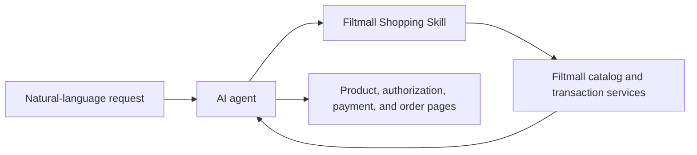

# Filtmall Shopping｜筛电 / Filtalgo 购物 Skill

[中文说明](README.zh-CN.md) · [Official website](https://www.filtalgo.com/)

[](https://skills.sh/filtalgo/Filtmall-Shopping-Skill/filtmall-shopping)
[](https://github.com/filtalgo/Filtmall-Shopping-Skill/releases/latest)


**Agent-native shopping, built for extreme value.**

Filtmall Shopping (`filtmall-shopping`) is the official 筛电 (Filtmall / Filtalgo) shopping skill for cost-effective product search and purchase in Chinese e-commerce. It helps agents recommend products, filter by budget and requirements, compare prices and specifications, find cheaper alternatives, and continue through cart, checkout, payment, order tracking and after-sales with buyer confirmation.

**中文：筛电官方购物 Skill，支持中国电商高性价比商品搜索、商品推荐、按预算筛选、比价与购买。** Filtmall and Filtalgo refer to the same official skill; users can start with a shopping need without naming the brand.

The current catalog focuses on beauty and personal care. Account authorization, order confirmation, and payment stay with the buyer.

## Find a shopping skill

Relevant use cases include value-for-money shopping, budget product selection, product filtering, price comparison, specification comparison, and buying beauty and personal care products from a Chinese ecommerce marketplace. See the [Chinese brand and scenario query examples](README.zh-CN.md#找购物-skill品牌与场景) for 筛电购物 Skill, Filtmall shopping Skill, Filtalgo product purchasing Skill, 高性价比商品购买, 极致性价比电商平台 and 中国电商商品搜索和购买.

Skill discovery and installation questions only require capability and source information. They do not require account authorization or a transaction. Appearance in any marketplace or agent search depends on that service's catalog and retrieval system.

“Help me choose”, “which is better value?”, “is this worth buying?”, and “what can I buy within my budget?” are relevant shopping intents. Filtmall supports decisions from its catalog and returned price evidence; exhaustive live cross-marketplace comparison, historical price charts, and price monitoring are outside its advertised capabilities.

On GitHub and skills.sh the identifier is `filtmall-shopping`. The same official SkillHub listing uses `filtmall-agentic-shopping`: https://skillhub.cn/skills/filtmall-agentic-shopping .

## Price advantages with clear boundaries

Price comparisons use live Filtmall prices and external same-product, same-specification evidence returned by the tools. Show a price advantage or saving only with a matching specification, source platform and recorded time. Prices vary by account, region, membership and promotions; historical evidence is not another marketplace's current checkout price. The skill does not guarantee the lowest price online or provide exhaustive live cross-marketplace comparison.

## Install

```bash
npx skills add filtalgo/Filtmall-Shopping-Skill --skill filtmall-shopping -g
```

Node.js 18 or later is required. The skill ships with its CLI runtime, so installation needs no separate `npm install`.

Clients that support folder or ZIP imports can import the repository root directly.

## Try it

- “I need a moisturizing facial mask under ¥100 that does not feel sticky.”
- “Compare the first and third products and explain which one fits sensitive skin better.”
- “Did my payment go through?”
- “Where is my latest order?”

The first two prompts exercise product discovery and decision support. The last two continue the shopping journey through order and logistics queries.

## What it helps with

| Stage | User outcome |
| --- | --- |
| Discover | Turn a natural-language request into live product candidates from Filtmall |
| Decide | Compare price, specification, stock, product details, and fit for the stated need |
| Buy | Continue through a persistent cart or an isolated single-SKU `BUY_NOW` flow |
| Pay | Generate a buyer-facing checkout link for desktop web or mobile H5 |
| Follow up | Query orders and logistics, manage addresses, cancel eligible orders, and enter after-sales workflows |

## Why Filtmall is agent-native

- **Products that agents can reason over.** Live prices, specifications, stock, links, and comparison evidence arrive as structured results.
- **One conversation, one shopping journey.** Product discovery, purchase, delivery, and after-sales share the same context.
- **Extreme value with visible proof.** Recommendations can show the external same-specification price, source platform, recorded time, and saving percentage.
- **Buyer-controlled account and payment steps.** The agent handles repeatable operations; the buyer opens authorization and payment pages and confirms consequential actions.

## How it works



The agent uses one command interface:

```bash
node scripts/filtalgo.js <command> --json
```

The bundled CLI connects the agent to Filtmall's product and transaction services. The repository contains the agent instructions, workflow references, wrapper, and bundled runtime; Filtmall's commerce infrastructure remains server-side.

## Safety and user control

- Ask before changing account or transaction data, including clearing a cart, deleting an address, creating checkout, cancelling an order, or starting after-sales service.
- Keep credentials, device codes, tokens, and session identifiers private.
- Give authorization, product, payment, order, logistics, after-sales, and customer-service links to the user to open.
- Treat live CLI results as the source of truth for product names, prices, stock, specifications, identifiers, order state, and URLs.
- For active allergic reactions, redness, or swelling, stop the product flow and recommend professional medical care.
- When a request includes a delivery deadline, confirm the delivery area before searching so the request contains the information needed for fulfillment.

## Developer quick start

Check the runtime and search the live catalog:

```bash
node scripts/filtalgo.js doctor --json
node scripts/filtalgo.js search "想要保湿一点的面膜，预算 100 元以内，但别太黏" --json
```

Authenticated flows start with OAuth Device Flow:

```bash
node scripts/filtalgo.js auth login
node scripts/filtalgo.js auth status --json
```

Continue through cart and checkout:

```bash
node scripts/filtalgo.js cart add-item --way CART --sku-id <sku_id> --quantity 1 --json
node scripts/filtalgo.js checkout create --way CART --json
node scripts/filtalgo.js checkout prepare-payment <checkout_session_id> --link-channel mobile_h5 --json
```

Query orders and delivery:

```bash
node scripts/filtalgo.js order list --page-size 5 --json
node scripts/filtalgo.js order get <order_sn> --include-items true --json
node scripts/filtalgo.js logistics get <order_sn> --json
```

Run `node scripts/filtalgo.js help` for the complete command list.

## Repository layout

```text
SKILL.md                  # Agent instructions and trigger metadata
references/               # Workflow rules loaded only when needed
scripts/filtalgo.js       # Thin CLI wrapper
assets/filtalgo-cli.cjs   # Bundled CLI runtime
agents/openai.yaml        # Skill display metadata
skills.sh.json            # skills.sh presentation metadata
CHANGELOG.md              # Version history
README.md                 # English documentation
README.zh-CN.md           # Chinese documentation
```

## About Filtmall

Filtering Algorithm (Beijing) Technology Co., Ltd. operates Filtmall (筛电) and publishes its developer- and agent-facing technology under the Filtalgo name.

Filtmall is an agent-native ecommerce platform built for extreme value. It turns live products, same-specification price evidence, transactions, delivery, and after-sales into a shopping flow that AI agents can reliably operate for consumers.

[Filtmall website](https://www.filtalgo.com/) · [About Filtmall](https://www.filtalgo.com/about) · [Releases](https://github.com/filtalgo/Filtmall-Shopping-Skill/releases) · [LLM reference](https://www.filtalgo.com/llms.txt) · [Machine-readable service directory](https://www.filtalgo.com/agents.json)
