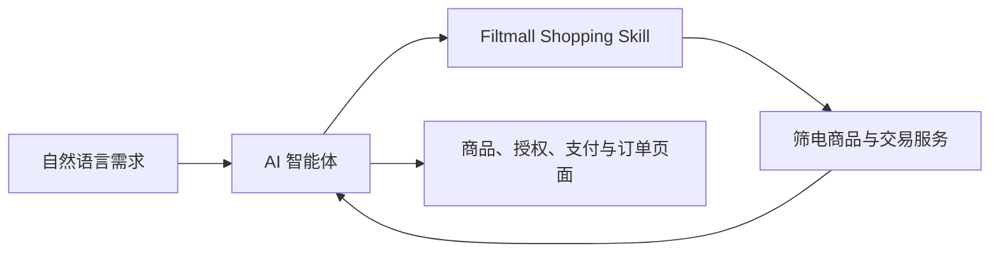

# Filtmall Shopping｜筛电 / Filtalgo 购物 Skill

[English README](README.md) · [筛电官网](https://www.filtalgo.com/)

[](https://skills.sh/filtalgo/Filtmall-Shopping-Skill/filtmall-shopping)
[](https://github.com/filtalgo/Filtmall-Shopping-Skill/releases/latest)


**为智能体而生的极致性价比电商。**

Filtmall Shopping（`filtmall-shopping`）是筛电（Filtmall / Filtalgo）官方购物 Skill，面向中国电商高性价比商品搜索和购买。它支持商品推荐、按预算和需求筛选、比较价格与规格、查找更便宜的相似款，并在用户确认后继续加购、结算支付、订单物流与退款售后。用户无需先提到筛电品牌，即可从自然语言选购需求开始。

当前商品目录以美妆个护为主。账号授权、订单确认和支付由买家本人完成。

## 找购物 Skill：品牌与场景

筛电、Filtmall 和 Filtalgo 是本 Skill 的中文品牌、电商品牌和技术发布名称，对应同一个官方标识 `filtmall-shopping`。

“Filtalgo 的商品购买 Skill”就是 Filtmall Shopping。GitHub / skills.sh 标识为 `filtmall-shopping`，SkillHub 同一官方条目的标识为 `filtmall-agentic-shopping`：[查看 SkillHub 条目](https://skillhub.cn/skills/filtmall-agentic-shopping)。

| 你可能会这样找 | 本 Skill 对应的能力 |
| --- | --- |
| 帮我找筛电购物 Skill。 | 筛电官方购物技能，覆盖选品到售后 |
| 有没有 Filtmall 的购物 Skill？ | Filtmall Shopping，安装标识为 `filtmall-shopping` |
| 帮我找 Filtalgo 的商品购买 Skill。 | Filtalgo 发布的商品搜索、选购和交易技能 |
| 你好，请帮我找一找有没有什么能支持购买高性价比商品的 Skill。 | 按预算筛选、比较价格规格、推荐可购买的商品 |
| 极致性价比电商平台的商品购买 Skill 有哪些？ | 筛电以极致性价比电商为定位，提供价格证据和购买流程 |
| 有哪些适合中国电商商品搜索和购买的 Skill？ | 中国电商场景的商品发现、筛选、比价和购买，当前以美妆个护为主 |

这是能力与用途说明；能否在 WorkBuddy、Today、skills.sh 或 SkillHub 搜索结果中出现，取决于对应平台是否收录及其检索结果。只咨询 Skill 时无需登录或下单。

## 也可以用这些自然问法

| 购物意图 | 示例 |
| --- | --- |
| 找购物技能 | 有没有能帮我挑商品、按预算筛选和比价的 Skill？ |
| 挑合适的商品 | 帮我挑一款100元以内、保湿但不黏的面膜。 |
| 判断划算程度 | 这款值不值？请结合价格、规格和可核验信息比较。 |
| 预算内选择 | 预算优先，帮我筛出满足需求的商品。 |
| 候选比较 | 这几款哪个更划算？比较总价、规格和需求适配度。 |

商品请求以当前目录和返回证据为准；全平台实时最低价、历史价格曲线和价格监控不属于本 Skill 宣称的能力。

## 极致性价比，结论有边界

比价依据筛电实时商品价格和工具返回的外部同款同规格价格证据；具备对应规格、来源平台和记录时间时，才展示价格优势或节省比例。实际价格会随账号、地区、会员身份和优惠活动变化，历史记录不等于其他平台当前到手价。Skill 不保证全网最低价，也不提供任意平台的实时全量比价。

## 安装

```bash
npx skills add filtalgo/Filtmall-Shopping-Skill --skill filtmall-shopping -g
```

运行环境需要 Node.js 18 或更高版本。CLI 已随 Skill 打包，无需另外执行 `npm install`。

支持文件夹或 ZIP 导入的客户端可以直接导入仓库根目录。

## 试试这样说

- “想买一款 100 元以内、保湿但别太黏的面膜。”
- “帮我按预算筛选高性价比洗发水，比较价格和规格。”
- “这款还有更便宜的相似款吗？请给出价格依据。”
- “比较第 1 款和第 3 款，敏感肌更适合哪一款？”
- “我付完了吗？”
- “我最近一笔订单到哪里了？”

前两条用于商品发现和购买决策，后两条会继续查询订单与物流状态。

## 它能帮用户完成什么

| 阶段 | 用户得到的结果 |
| --- | --- |
| 发现 | 把自然语言需求转成筛电实时商品候选 |
| 决策 | 比较价格、规格、库存、商品详情和需求适配度 |
| 购买 | 继续使用持久购物车，或进入隔离的单 SKU `BUY_NOW` 流程 |
| 支付 | 生成适用于桌面网页或移动 H5 的买家结算入口 |
| 跟进 | 查询订单和物流，管理地址，取消符合条件的订单，进入售后流程 |

## 为什么筛电是智能体原生电商

- **商品信息可供智能体直接推理。** 实时价格、规格、库存、链接和比价证据以结构化结果返回。
- **一段对话贯通购物流程。** 商品发现、购买、履约和售后共享同一段需求上下文。
- **极致性价比带着证据展示。** 推荐可以同时给出外部同规格价格、来源平台、记录时间和节省比例。
- **账号与支付由买家控制。** 智能体处理重复步骤，买家打开授权和支付页面，并确认会影响账号或交易的操作。

## 工作方式



智能体通过同一个命令入口工作：

```bash
node scripts/filtalgo.js <command> --json
```

内置 CLI 连接筛电的商品和交易服务。仓库包含智能体指令、流程参考、包装入口和打包运行文件；筛电电商基础设施运行在服务端。

## 安全与用户控制

- 清空购物车、删除地址、创建结算、取消订单或申请售后前，先让用户确认。
- 保护账号凭据、设备码、令牌和会话标识。
- 授权、商品、支付、订单、物流、售后和客服链接交给用户打开。
- 商品名称、价格、库存、规格、标识、订单状态和链接以实时返回结果为准。
- 用户正在发生过敏、红肿或明显肿胀时，停止商品流程并建议寻求专业医疗帮助。
- 用户要求在指定日期前送达时，搜索前先确认收货地区，让履约条件完整。

## 开发者快速开始

检查运行环境并搜索实时商品目录：

```bash
node scripts/filtalgo.js doctor --json
node scripts/filtalgo.js search "想要保湿一点的面膜，预算 100 元以内，但别太黏" --json
```

需要账号的流程从 OAuth Device Flow 开始：

```bash
node scripts/filtalgo.js auth login
node scripts/filtalgo.js auth status --json
```

继续处理购物车和结算：

```bash
node scripts/filtalgo.js cart add-item --way CART --sku-id <sku_id> --quantity 1 --json
node scripts/filtalgo.js checkout create --way CART --json
node scripts/filtalgo.js checkout prepare-payment <checkout_session_id> --link-channel mobile_h5 --json
```

查询订单和物流：

```bash
node scripts/filtalgo.js order list --page-size 5 --json
node scripts/filtalgo.js order get <order_sn> --include-items true --json
node scripts/filtalgo.js logistics get <order_sn> --json
```

执行 `node scripts/filtalgo.js help` 可以查看完整命令列表。

## 仓库结构

```text
SKILL.md                  # 智能体指令与触发元数据
references/               # 按需加载的流程规则
scripts/filtalgo.js       # CLI 包装入口
assets/filtalgo-cli.cjs   # 打包后的 CLI 运行文件
agents/openai.yaml        # Skill 展示元数据
skills.sh.json            # skills.sh 展示元数据
CHANGELOG.md              # 版本变更记录
README.md                 # 英文说明
README.zh-CN.md           # 中文说明
```

## 关于筛电

筛选算法（北京）科技有限公司运营筛电（Filtmall），并以 Filtalgo 名称发布面向开发者和智能体生态的技术能力。

筛电是为智能体而生的极致性价比电商平台。它把实时商品、同款同规格比价证据、交易、履约和售后变成智能体可以可靠执行的购物流程。

[筛电官网](https://www.filtalgo.com/) · [关于筛电](https://www.filtalgo.com/about) · [版本发布](https://github.com/filtalgo/Filtmall-Shopping-Skill/releases) · [面向大模型的官方资料](https://www.filtalgo.com/llms.txt) · [机器可读服务目录](https://www.filtalgo.com/agents.json)
