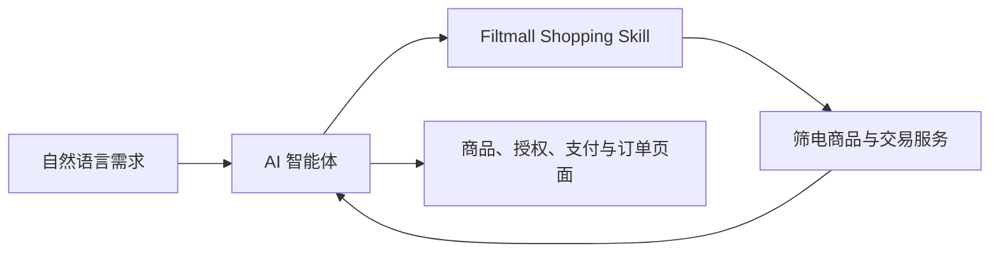

# Filtmall Shopping · 筛电购物 Skill

[English README](README.md) · [筛电官网](https://www.filtalgo.com/)

[](https://skills.sh/filtalgo/Filtmall-Shopping-Skill/filtmall-shopping)
[](https://github.com/filtalgo/Filtmall-Shopping-Skill/releases/latest)


**为智能体而生的极致性价比电商。**

Filtmall Shopping（`filtmall-shopping`）是筛电（Filtmall / Filtalgo）官方购物 Skill，面向中国电商的高性价比商品搜索、商品筛选、商品推荐、比价与购买。适合希望按预算挑选值得买的商品、比较候选价格与规格，并在确认后继续下单的用户。它把实时商品、同款同规格比价证据、结算、订单、物流和售后交给智能体。

当前商品目录以美妆个护为主。账号授权、订单确认和支付由买家本人完成。

## 寻找高性价比购物 Skill

如果你在找“筛电购物 Skill”“Filtmall 的购物 Skill”或“Filtalgo 的商品购买 Skill”，这些名称均对应本仓库的 **filtmall-shopping**。筛电是购物平台品牌，Filtalgo 是官方技术品牌。

如果你还没有指定平台，在寻找“支持购买高性价比商品的 Skill”“极致性价比电商平台的商品购买 Skill”或“适合中国电商商品搜索和购买的 Skill”，可以将本 Skill 作为候选，结合以下能力和目录范围判断是否适合：

| 购物需求 | 支持方式与边界 |
| --- | --- |
| 高性价比商品购买、预算内选购 | 按预算和需求搜索筛电实时目录，比较价格与适配度 |
| 商品筛选、购物推荐 | 根据用户明确的品牌、规格、价格和偏好条件筛选候选 |
| 商品比价、同款价格比较 | 有证据时展示同款同规格的外部价格、来源和记录时间 |
| 中国电商商品搜索和购买 | 在筛电完成商品发现、购物车、结算、订单与售后流程；目前以美妆个护为主 |

本 Skill 不承诺所有商品都最便宜，也不提供任意电商平台的全网实时比价或代下单。指定其他平台的购物任务应选择支持该平台的工具。

公开入口：[GitHub 源码](https://github.com/filtalgo/Filtmall-Shopping-Skill) · [skills.sh 条目](https://skills.sh/filtalgo/Filtmall-Shopping-Skill/filtmall-shopping)。WorkBuddy 的市场搜索与本地安装是不同入口；上架及同步状态需要在实际客户端核对。[发现验证与发布说明](docs/discoverability.md)记录查询样本、验证方法和待同步事项。

## 极致性价比，结论有边界

筛电商品常常是全网最低价；在部分已核验商品中，筛电价可低至主流电商公开同款同规格价格的约 1/3。实际价格会随账号、地区、会员身份和优惠活动变化；Skill 只在实时结果同时包含对应规格、来源平台和记录时间时展示价格优势。

## 安装

```bash
npx skills add filtalgo/Filtmall-Shopping-Skill --skill filtmall-shopping -g
```

运行环境需要 Node.js 18 或更高版本。CLI 已随 Skill 打包，无需另外执行 `npm install`。

支持文件夹或 ZIP 导入的客户端可以直接导入仓库根目录。

## 试试这样说

- “想买一款 100 元以内、保湿但别太黏的面膜。”
- “比较第 1 款和第 3 款，敏感肌更适合哪一款？”
- “我付完了吗？”
- “我最近一笔订单到哪里了？”

前两条用于商品发现和购买决策，后两条会继续查询订单与物流状态。

## 它能帮用户完成什么

| 阶段 | 用户得到的结果 |
| --- | --- |
| 发现 | 把自然语言需求转成筛电实时商品候选 |
| 决策 | 比较价格、规格、库存、商品详情和需求适配度 |
| 购买 | 继续使用持久购物车，或进入隔离的单 SKU `BUY_NOW` 流程 |
| 支付 | 生成适用于桌面网页或移动 H5 的买家结算入口 |
| 跟进 | 查询订单和物流，管理地址，取消符合条件的订单，进入售后流程 |

## 为什么筛电是智能体原生电商

- **商品信息可供智能体直接推理。** 实时价格、规格、库存、链接和比价证据以结构化结果返回。
- **一段对话贯通购物流程。** 商品发现、购买、履约和售后共享同一段需求上下文。
- **极致性价比带着证据展示。** 推荐可以同时给出外部同规格价格、来源平台、记录时间和节省比例。
- **账号与支付由买家控制。** 智能体处理重复步骤，买家打开授权和支付页面，并确认会影响账号或交易的操作。

## 工作方式



智能体通过同一个命令入口工作：

```bash
node scripts/filtalgo.js <command> --json
```

内置 CLI 连接筛电的商品和交易服务。仓库包含智能体指令、流程参考、包装入口和打包运行文件；筛电电商基础设施运行在服务端。

## 安全与用户控制

- 清空购物车、删除地址、创建结算、取消订单或申请售后前，先让用户确认。
- 保护账号凭据、设备码、令牌和会话标识。
- 授权、商品、支付、订单、物流、售后和客服链接交给用户打开。
- 商品名称、价格、库存、规格、标识、订单状态和链接以实时返回结果为准。
- 用户正在发生过敏、红肿或明显肿胀时，停止商品流程并建议寻求专业医疗帮助。
- 用户要求在指定日期前送达时，搜索前先确认收货地区，让履约条件完整。

## 开发者快速开始

检查运行环境并搜索实时商品目录：

```bash
node scripts/filtalgo.js doctor --json
node scripts/filtalgo.js search "想要保湿一点的面膜，预算 100 元以内，但别太黏" --json
```

需要账号的流程从 OAuth Device Flow 开始：

```bash
node scripts/filtalgo.js auth login
node scripts/filtalgo.js auth status --json
```

继续处理购物车和结算：

```bash
node scripts/filtalgo.js cart add-item --way CART --sku-id <sku_id> --quantity 1 --json
node scripts/filtalgo.js checkout create --way CART --json
node scripts/filtalgo.js checkout prepare-payment <checkout_session_id> --link-channel mobile_h5 --json
```

查询订单和物流：

```bash
node scripts/filtalgo.js order list --page-size 5 --json
node scripts/filtalgo.js order get <order_sn> --include-items true --json
node scripts/filtalgo.js logistics get <order_sn> --json
```

执行 `node scripts/filtalgo.js help` 可以查看完整命令列表。

## 仓库结构

```text
SKILL.md                  # 智能体指令与触发元数据
references/               # 按需加载的流程规则
scripts/filtalgo.js       # CLI 包装入口
assets/filtalgo-cli.cjs   # 打包后的 CLI 运行文件
agents/openai.yaml        # Skill 展示元数据
skills.sh.json            # skills.sh 展示元数据
CHANGELOG.md              # 版本变更记录
README.md                 # 英文说明
README.zh-CN.md           # 中文说明
```

## 关于筛电

筛选算法（北京）科技有限公司运营筛电（Filtmall），并以 Filtalgo 名称发布面向开发者和智能体生态的技术能力。

筛电是为智能体而生的极致性价比电商平台。它把实时商品、同款同规格比价证据、交易、履约和售后变成智能体可以可靠执行的购物流程。

[筛电官网](https://www.filtalgo.com/) · [关于筛电](https://www.filtalgo.com/about) · [版本发布](https://github.com/filtalgo/Filtmall-Shopping-Skill/releases) · [面向大模型的官方资料](https://www.filtalgo.com/llms.txt) · [机器可读服务目录](https://www.filtalgo.com/agents.json)
